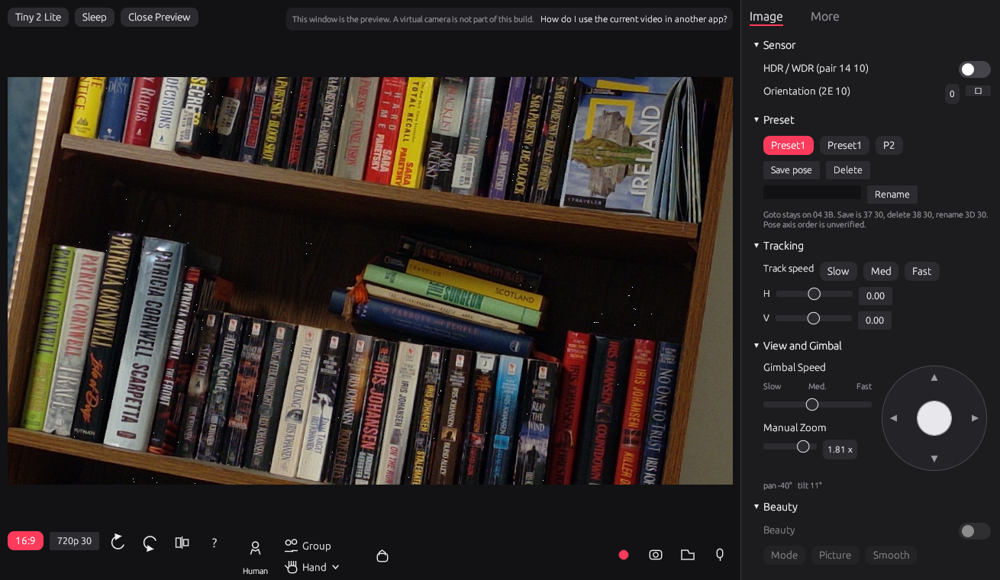
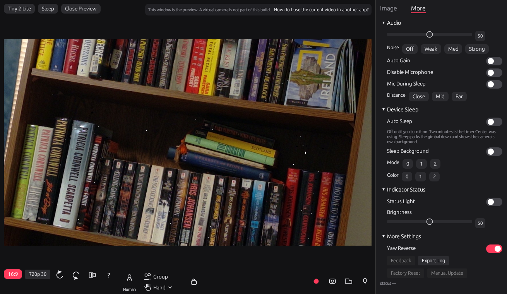

# OBSBOT Center for Linux

A Linux port of OBSBOT Center for the Tiny 2 Lite (`3564:fef9`). It runs on Ubuntu. The window is a native egui app: it previews the camera and drives the gimbal, zoom, image controls, and the AI tracking modes that have been checked on the hardware. The control protocol is a Rust port of the vendor commands in OBSBOT Center's `libdev.dll`.

The camera on this project is product type 3 (Tail2Lite). Vendor commands go out on the UVC extension unit through the kernel's `uvcvideo` driver, not over HID. The Tiny 2 Lite does not expose a HID interface.





## What the panel does

Checked on a live Tiny 2 Lite under Ubuntu 26.04:

- 720p30 MJPEG preview.
- Gimbal pad and speed. Pan moves in 1° steps. The pad sends absolute pan and tilt.
- Manual zoom through the standard UVC zoom control.
- Human tracking. The gimbal follows a person.
- Hand tracking. The Hand button opens the menu. On and Off are the switch. The menu closes when you click the picture. The Hand button stays lit while tracking is on.
- Yaw reverse. With the switch on, dragging the pad left pans the opposite way. Tilt is unchanged.
- Image controls the camera reports, including focus, exposure, white balance, and the sharpness and backlight sliders.
- Sleep and wake, auto-sleep, the status light, and the More-tab audio and sleep-background controls. Those were exercised and the USB link stayed up.

Present, with a limit you should know about:

- Group is on the bar. It was not retested after human tracking started following.
- Left and Right in the hand menu do not pick a hand. The firmware command that turns hand tracking on follows either hand. The pills only show which one is selected.
- Tracking Range is visible and does not send a command. The boundary pack is not wired.
- Orientation accepts values 0 through 3 and the preview stays upright.
- Preset goto uses the legacy command. Save, Delete, and Rename are on the Image tab and were not used.
- Beauty is drawn as a control. The effect in the official app runs in a Windows library and is not in this build.
- Factory Reset and Manual Update are disabled. Factory reset is never sent.
- The record, snapshot, and folder buttons are in the toolbar. A virtual camera is not part of this build. The line above the preview says so.

## Run it on Ubuntu

Built and run on Ubuntu 26.04.1 with rustc 1.93.1. The crate uses the 2021 edition. You need a desktop session, because the panel is a window. A headless machine has nowhere to draw it.

### 1. Packages

These are the compiler and window libraries that were installed on the machine that built the panel:

```sh
sudo apt update
sudo apt install build-essential pkg-config libxkbcommon-dev libwayland-dev libgl1-mesa-dev libegl1-mesa-dev libxcb1-dev
```

### 2. Rust

If `rustc --version` is missing, install the stable toolchain:

```sh
curl --proto '=https' --tlsv1.2 -sSf https://sh.rustup.rs | sh
. "$HOME/.cargo/env"
```

Open a new terminal after that so `cargo` is on `PATH`.

### 3. Camera

Plug the Tiny 2 Lite into a USB port. Ubuntu's kernel binds `uvcvideo` on its own. Confirm the device and a video node:

```sh
lsusb -d 3564:fef9
ls -l /dev/video*
```

The panel scans `/dev/video0` through `/dev/video15` for the node whose name contains `OBSBOT`. A desktop session usually gets permission to those nodes when the camera is plugged in. If the open fails, add your user to the `video` group and log in again:

```sh
sudo usermod -aG video "$USER"
```

### 4. Build and run

The first build downloads the crates, so it needs a network. Later builds can pass `--offline`.

```sh
git clone https://github.com/tehlulzywolf/obsbot.git
cd obsbot/obsbot-core
cargo run --example panel --features panel
```

That compiles the panel and opens the window on the current display. Leave the preview at 30 fps. A 60 fps preview on a usbip link has dropped the camera while a vendor write was in flight.

### 5. Tests

The tests do not open the camera.

```sh
cd obsbot-core
cargo test
cargo test --example panel --features panel
```

The first command is the codec and device tests. The second runs the panel's unit tests.

## From Windows, through WSL

The same Ubuntu userland runs under WSL2. Attach the camera from Windows PowerShell with [usbipd-win](https://github.com/dorssel/usbipd-win), using the bus id `usbipd list` prints for `3564:fef9`:

```powershell
usbipd list
usbipd attach --wsl --busid <BUSID>
```

`usbipd detach --busid <BUSID>` gives the camera back to Windows. Inside Ubuntu, build and run with the same `cargo` commands. WSLg provides the display.

`obsbot-core/run_panel.sh` is only for that WSLg case. It restarts the already-built debug binary if WSLg drops the connection, and it points the process at WSLg's runtime directory. Do not use it on a normal Ubuntu desktop.

## Repository

| Path | What it is |
|---|---|
| `obsbot-core/` | The Rust crate, the panel, and the tests |
| `obsbot-center/analysis/HANDOFF.md` | Current protocol notes, including what was confirmed on the camera |
| `obsbot-center/reports/` | Earlier isolation write-ups. The top of each report says what a later pass replaced |
| `obsbot-linuxkit/` | Small Linux helpers from the first bring-up |
| `docs/images/` | The screenshots above |

USB captures and build output are not in the repository. The notes taken from the captures are.

## License

MIT. See [LICENSE](LICENSE).
