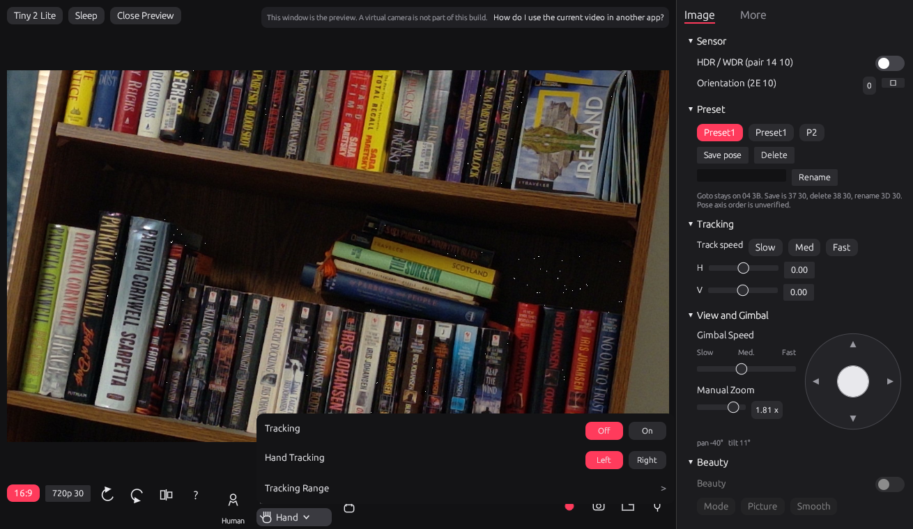

# OBSBOT Center for Linux

A Linux panel for the OBSBOT Tiny 2 Lite (`3564:fef9`). It previews the camera and drives the gimbal, zoom, image controls, and the AI tracking modes that have been checked on the hardware. The control protocol is a Rust port of the vendor commands in OBSBOT Center's `libdev.dll`. The window is an egui app running under WSLg.

The camera on this project is product type 3 (Tail2Lite). Vendor commands go out on the UVC extension unit through the kernel, not over HID. The Tiny 2 Lite does not expose a HID interface.




## What the panel does

Checked on a live Tiny 2 Lite attached to WSL with usbip:

- 720p30 MJPEG preview.
- Gimbal pad and speed. Pan moves in 1° steps. The pad sends absolute pan and tilt.
- Manual zoom through the standard UVC zoom control.
- Human tracking. The gimbal follows a person.
- Hand tracking. The Hand button opens the menu. On and Off are the switch. The menu closes when you click the picture. The Hand button stays lit while tracking is on.
- Yaw reverse. With the switch on, dragging the pad left pans the opposite way. Tilt is unchanged.
- Image controls the camera reports, including focus, exposure, white balance, and the sharpness and backlight sliders.
- Sleep and wake, auto-sleep, the status light, and the More-tab audio and sleep-background controls. Those were exercised and the USB link stayed up.

Present, with a limit you should know about:

- Group is on the bar. It was not retested after human tracking started following.
- Left and Right in the hand menu do not pick a hand. The firmware command that turns hand tracking on follows either hand. The pills only show which one is selected.
- Tracking Range is visible and does not send a command. The boundary pack is not wired.
- Orientation accepts values 0 through 3 and the preview stays upright.
- Preset goto uses the legacy command. Save, Delete, and Rename are on the Image tab and were not used.
- Beauty is drawn as a control. The effect in the official app runs in a Windows library and is not in this build.
- Factory Reset and Manual Update are disabled. Factory reset is never sent.
- The record, snapshot, and folder buttons are in the toolbar. A virtual camera is not part of this build. The line above the preview says so.

## Prerequisites

- Windows 10 or 11, with WSL2 and WSLg.
- [usbipd-win](https://github.com/dorssel/usbipd-win), so the camera can be attached to the Linux VM.
- Rust inside WSL. This tree was built with rustc 1.93.1. The crate uses the 2021 edition.
- The Linux user in the `video` group, so it can open `/dev/video*`.
- An OBSBOT Tiny 2 Lite on USB.

## Setup

From the repository root, inside WSL:

```sh
cd obsbot-core
cargo test --offline
cargo build --offline --example panel --features panel
```

`cargo test` does not need the camera. The panel feature pulls in egui.

Attach the camera from Windows PowerShell. Use the bus id that `usbipd list` prints for `3564:fef9`. On the machine this was developed on, that bus was `8-2`.

```powershell
usbipd list
usbipd attach --wsl --busid <BUSID>
```

Give it back to Windows with `usbipd detach --busid <BUSID>`.

## Run

From `obsbot-core` in WSL, with WSLg providing `DISPLAY`:

```sh
cargo run --offline --example panel --features panel
```

`run_panel.sh` restarts the already-built debug binary if WSLg drops the connection. It does nothing if a panel process is already running.

The preview stays at 30 fps. A 60 fps preview on this usbip link has dropped the camera while a vendor write was in flight.

## Test

```sh
cd obsbot-core
cargo test --offline
cargo test --offline --example panel --features panel
```

The first command is the codec and device tests. The second runs the panel's unit tests. Neither one opens the camera.

## Repository

| Path | What it is |
|---|---|
| `obsbot-core/` | The Rust crate, the panel, and the tests |
| `obsbot-center/analysis/HANDOFF.md` | Current protocol notes, including what was confirmed on the camera |
| `obsbot-center/reports/` | Earlier isolation write-ups. The top of each report says what a later pass replaced |
| `obsbot-linuxkit/` | Small Linux helpers from the first bring-up |
| `docs/images/` | The screenshots above |

USB captures and build output are not in the repository. The notes taken from the captures are.

## License

MIT. See [LICENSE](LICENSE).
